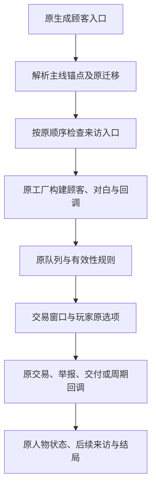

# 原任务流程与显示归属

本记录逐项描述原任务，不新建、替换或删减任务。源依据是当前出厂程序集的被动CIL与原字段常量；源码读取不等于自然来访、完整营业日或结局实机通过。已通过的显示与设备通路沿原记录，不重跑。宋国刺客标板继续待定。

## 8.1.1 日程、顾客队列与主线开端

本子项已完成源流程整理。游戏生成顾客时调用 `StorylineSchedule.Resolve(today)`，随后处理特殊来访、执法、日常、人物线、事件和服务队列。各入口产生的是原顾客，能否最终到达交易窗口还受原队列、有效性、冷却和优先级规则影响，不能把加入队列等同已经来访。

| 主线标识 | 原名义起日 | 实际起日来源 |
|---|---:|---|
| georgio | 6 | 已有 storylineAnchors 值，否则回退名义值 |
| lun | 11 | 同上 |
| nellis | 21 | 同上 |
| eleanor | 23 | 同上 |
| serpico | 40 | 同上 |

`Resolve` 在原锚点表不存在时建立表；首次未标记 seeded 时，为LEGACY中的这五条线补入缺失的名义锚点，再标记 seeded。之后按名义日排序处理Known中的缺失项：未过名义日用名义日，已过则从今日+2开始，避开与现有锚点相距不足4日的日期。**当前LEGACY与Known都包含上述五条**，因此不能把补排逻辑说成所有普通错过来访都自动补发；已有锚点不会仅因日期过去而重新排期。

顾客生成先运行原Eleanor保释迁移，再按原顺序处理特殊脚本、救济、私帮、Eleanor提前来访、事件／引导、查验、供货、解锁、人物线、远行、情报、工匠、普通／通缉／服务等入口，末段还运行房租、John Smith后续、Lou药包和线人队列。原早／中／晚MOD钩子全部保持。本MOD没有更改任何一项调度。

另一组宗教人物剧情在 `HandleClientFromStoryLine` 中使用固定日，**不属于上述五条锚点表**：该函数内第3／10日传教者，第5／12／19／26／33／43日Abby各阶段与结局，第40／47日工程师各阶段。后续8.1.7归属已确认：当前静态索引未发现该日程函数的原调用者，不能据此认定正常游戏将自然出现，更不能认定剧情通过；本MOD不新增激活。

源文件：`evidence/content-prep/original-task-flow/StorylineSchedule.il`、`StoreClientManager-GenerateClient.il`、`StoreClientManager-HandleClientFromStoryLine.il`；程序集身份见同目录 `source-manifest.json`。本项不启动游戏、不读写存档、不执行DebugReanchor或任何任务方法，也不生成无内容的游戏版本。

## 后续队列

8.1.2 [艾丽诺源流程](QUEST_ELEANOR.zh-CN.md)已完成；8.1.3 [瑟皮科源流程](QUEST_SERPICO.zh-CN.md)已完成；8.1.4 [乔治欧、伦与内利斯原线](QUEST_GEORGIO_LUN_NELLIS.zh-CN.md)已完成源整理，内利斯缺原日常调用的边界单列，不新增激活；8.1.5 [卢及关联线人／箱子／勒索](QUEST_LOU.zh-CN.md)已记录；8.1.6 [其余通缉主入口／周期](QUEST_WANTED.zh-CN.md)已记录，完整破坏触发等后续边界单列；8.1.7 [原宗教人物与手记](QUEST_CHURCH.zh-CN.md)已交付Alpha215显示，旧日程缺调用者的边界保持；8.1.8 [原组织／请求／服务入口](QUEST_ORGANIZATIONS_SERVICES.zh-CN.md)已整理，书信复用原17项范围；8.1.9 [特殊人物与全局终局](QUEST_SPECIAL_ENDINGS.zh-CN.md)已整理入口并交付Alpha216结局显示。下一8.2–8.6按用户规则整理可复用的原实机范围及剩余工作，不为未改变的原任务分支重复跑完整自然日。完整八级仍未完成。
