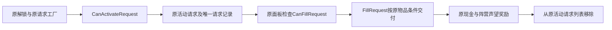

# 原组织、委托与服务入口

8.1.8 已完成本批原入口和通用流程归属。只读原CIL及本项目既有书信实现／证据；不改组织、服务、请求、库存或任务数据，不运行游戏或打开存档，不把通用流程代表性记录冒充每个请求／供应商的自然分支通过。

## 原私帮开局队列

`HandleCartelClient` 只在原startType==6、isCartelExited为假时处理：第1日原引介；第2日原执法角色与原瘾客；第3日原商贩；其后day%7==4为HandlerCheckin，day%7==1为HandlerWeekly。前三日判断优先于周期判断，不额外在第1日叠加周访。第9／18／27日的原受伤成员来访在上述判断之外，按原代码独立检查。

本MOD沿既有13坊私帮称呼／人物／对白显示，不把开局数值6改为宋金阵营，不改变退出组织、原每周上缴、原受伤成员所需物品或后果。具体顾客、选项和回调仍由StoreClientListCartel构造；主队列条件与各项付款／交物条件不能混成一个“支援分”。

## 原委托生命周期

原CanActivateRequest要求MarketplaceRequests已解锁；唯一请求未在seenRequest中，且同ID请求当前未活动。ActivateRequest的原force参数保留，本MOD不设置它来跳过条件。

原CanFillRequest对 `GetAllOwnedItems(false,true)` 返回的物件逐一调用原CanThisItemFillRequest。后者精确比较identifier与requiredItem；拒绝ITEM_BEHIND_LOCK_TAG；具有LOCKED_CONTAINER_TAG时继续采用原LOCK_STATUS布尔条件。本MOD不改ID、锁状态、类别或把中文名称当匹配条件。

这两个当前方法按匹配的GameItem对象个数累加，不按物品标价或unitCount建立新任务分。原FillRequest倒序处理同一原所有物列表，检查原物件、执行原交付检查、销毁已交付对象；达到requiredItemCount后原DispenseReward按factionId／reputationReward及creditReward发奖，再移除请求。这里不直接调用交付方法做审计，以免产生原交付作用。

原OnDayStart只使请求duration减1；过期的外层处理、具体请求工厂和商品特判沿原入口，不据这一行推断所有过期后果。本项目的显示层不修改原请求期限、质量判断、单件计价、奖励、seenRequest或活动列表。原特定请求（如食品、供能、香料、屠夫刀、伦聚会等）保持各自requiredItem与回调，不另造同名替代物。

## 原服务与书信界面

HandleServiceClient检查原StoreService.IsActive：买家引介选原购物顾客，卖家引介选原供货顾客；原黑市网络入口保留声望+2与RNG::Roll(50)的两类顾客分派；原特殊走私服务仍排原供货工厂。这里是该入口中的原数值，不写成每笔交易或每次寄信都必定增加声望。

本项目Correspondence把原拨号界面表现为书信名录，沿原六种名片与联系身份、登记、普通／大宗第二档服务、引介、冷却和失败状态。已有ledger17项实际覆盖登记、打开、寄出／取消确认、取消不执行服务、引介与冷却阻止重复、普通／大宗共用确认及Wild原服务；范围见[既有书信记录](CONTAINER_CORRESPONDENCE_SCOPE.zh-CN.md)。本轮复用该原范围，不为每个供应商重跑相同通路，也不宣称未覆盖的全部服务分支已经实机。

原供货报价、商品原身份与兼容、服务选项和任务后果不由显示词条改写；D1／D10称呼不会新增供货来源。未知外部MOD请求／书籍／服务继续沿其原逻辑和内容，原函数仍可调用，不被本批禁用或替换。

源输入：`evidence/content-prep/original-task-flow/StoreClientManager-HandleCartelClient.il`、`StoreClientManager-HandleServiceClient.il`、`StoreRequest.il`，以及原call-inputs、当前程序集source-manifest；书信代码为src/Correspondence.cs。下一8.1.9原特殊人物与全局终局入口归属，8.1与八级整体仍未因此完成。
