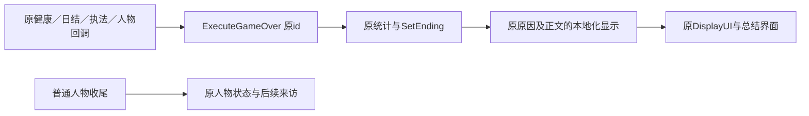

# 特殊人物与全局结局入口

8.1.9本批为原入口归属与结局显示整理，源于当前程序集的被动CIL，不是自然营业日或全结局实机记录。不调用任务工厂、结算、死亡、Debug或存档方法。原人物结局、全局终局和旧未挂接入口分别记录；不新增任务或激活旧剧情。

## 特殊人物

原箱物爱好者入口是 `HandleAlwayClient → HandleCaseEnjoyerClient`。原DisablePopCultureClients选项开启时直接返回；未初遇、今日>1，且CountCaseEnjoyerItems≥2时记录初遇、安排今日+7返回并排原顾客。计数遍历GetAllOwnedItems(false,true)，按ACCESS_CARD或SUPPLY_CRATE原类别计GameItem对象数，不按价格或堆叠单位计。原返回日到达、尚未返回时只排一次返回；返回顾客原预算1000、买上述两类、保留原开箱场景与离场拦截。没有加入66%交易点数。

原GrandpaCheng七个工厂及回调仍在程序集：Intro（FOOD/LUXURY_ITEM，预算200）、Referral（MEDICAL/LUXURY_ITEM，预算150）、第二访（MATERIAL/LUXURY_ITEM，预算200）、第三访、Sawyer转述、患病访与Wild转述。当前完整静态方法引用索引没有发现对这七个工厂的调用边；工厂对自身回调的ldftn不是调度入口。因此不虚构来访日、不将其称为现役完整人物线，也不以MOD新增调用。原第三访商品、患病访货品及Wild信物仍由原回调决定。

## 全局终局

原 `PlayerStore.ExecuteGameOver(id)` 先记录原分析/RunStats，再SetEnding(id)，按id读取原Mechanic原因与正文，最后DisplayUI。当前该函数有下列17个显式id分支；未知id仍沿原欠租文案回退，不由本MOD增加新结局。

| 原id | 原入口归属／结果 |
|---|---|
| rent | 原房东处置回调，欠租逐铺 |
| arrest | 原查验拘捕、无力缴罚；Debug入口另列，不作正常触发证明 |
| execution | 原GraftExecutionDialogue处置 |
| buyout | 原房东买断回调；DebugBuyout不作实际支付证明 |
| buyout_mortgage | 原贷方结清后对应回调 |
| repo | 原贷方收铺回调 |
| mob / sec / hitman | 原SetupWaitingClient按mob/sec/hitman派对应晨访；晨访终回调触发相应终局 |
| sentinel | HealthData.OnSleep原sentinelPool≥20时触发，原前置健康计算保持 |
| bombed | SetupRevBombing原c4_set→TriggerBombing→原延迟回调 |
| lou_bombed / lou_bombed_debt | Lou原玩具／债务失败路径传入TriggerBombing，详见卢流程 |
| cartel_retired | 原私帮晨访或周访／纯度链的原处置回调；不是正常退休成功 |
| vendor_permit | 原ExecuteGameOver已支持的显示分支；当前直接调用索引未见此id实参，不新增调用 |
| aug | 原日结回调中augPresence≥100，且难度augGameOverAtFullPresence或原AugMenace特质成立 |
| reactor | 同一原日结回调先检查ConsumeExplosion；成立则触发并返回，早于aug检查 |

本批完整收录21个静态ExecuteGameOver调用者（含两个日结调用位置、3个Debug调用者），只说明这些原入口及局部条件；不把每个回调的上游全部条件说成已经实机穷举。原Morning派发函数根据传入字符串设置人物后运行晨访，不是它本身计算阵营声望阈值。原租金、房价、贷款、罚款、难度和任务状态计算均保持。

原OnMortgagePaidOff本身仅清除isPayingMortgage、置IsPropertyPaid、记RunStats并OnStoreOwned；并非该方法一执行就直接弹结局。具体买断结局仍由贷方对应对话回调触发。

只有buyout及buyout_mortgage向原DisplayUI传true。其他上述分支传false；未知id回退也传false。原界面还按RunSummaryUI.CanOpen决定继续按钮是否直接显示，菜单按钮可打开原总结并传原canKeepPlaying与继续回调。不能把“按钮未直接显示”误报为买断后禁止继续。原ContinuePlayClick只关闭界面和遮罩、停止原结局音乐，本MOD不更改这些回调或音乐。

## 显示批次

结局原因／正文中的旧背景按D10处理，保留原命运与结果，不指定宋金。商品、疾病专名免疫宁／哨兵崩溃保持，卢的两种失败正文保持。仅复用FixtureText现有中文StringTableEntry映射；原表、id、统计、判定和回调不写入。未声明或外部MOD新增键保留原回退，英文沿原本地化。具体词条与交付见Alpha216批次记录。

原输入位于evidence/content-prep/original-task-flow：ending-callers.il、ending-call-edges.json、PlayerStore-ExecuteGameOver.il、GameOverUIManager.il、PlayerStore-SetupWaitingClient.il、PlayerStore-SetupRevBombing.il、PlayerStore-OnMortgagePaidOff.il、StoreClientManager-HandleCaseEnjoyerClient.il及原StoreClientUniqueList.il。collect_ending_inputs.py只运行既有Cecil工具读取文件，不加载游戏。8.1仍保留未整理的深层条件边界，不凭本记录勾满八级。

后续源补充：PlayerStore.OnLateShutterOpen按原IsPerkUnlocked依次检查LLLYNCH→mob、SEC_IMMEDIATE_ARREST→sec、UL_HITMAN→hitman、REV_HIT→SetupRevBombing、CARTEL_RETIRED→cartel。这五项原工厂perkThreshold均为-100、perkType=-1；实际入口读取的是原isUnlocked或isAlwaysActive状态，不另造中文声望判断。这是顺序独立if，并非随机选择一种，更不能断言同时命中时每个界面都已自然播放；仅没有currentClientInstance时才继续检查卢晨访。源文件PlayerStore-OnLateShutterOpen.il、StoreReputationPerk-native.il及StoreReputation-IsPerkUnlocked.il，不运行晚开门或任何处置方法。

Alpha216原特殊人物与全局终局入口0ID/0图/13key已交付安装，记录assets/v01/alpha216-ending-text/delivery.json。原全局结局13条显示按D10改为城中、巡检司、义军、13坊私帮与机巧语境；18条适用原文保留。只扩FixtureText既有中文表格式精确键映射，不写原Mechanic表、结局ID、统计、判定、金额、难度、日期、任务状态或继续回调；英文与未声明键沿原回退。复用既有本地化显示通路，无几何/业务重大改动，不重跑旧通路，无游戏/存档或新实机声明。下一8.2 原开张与日常循环记录收口。
